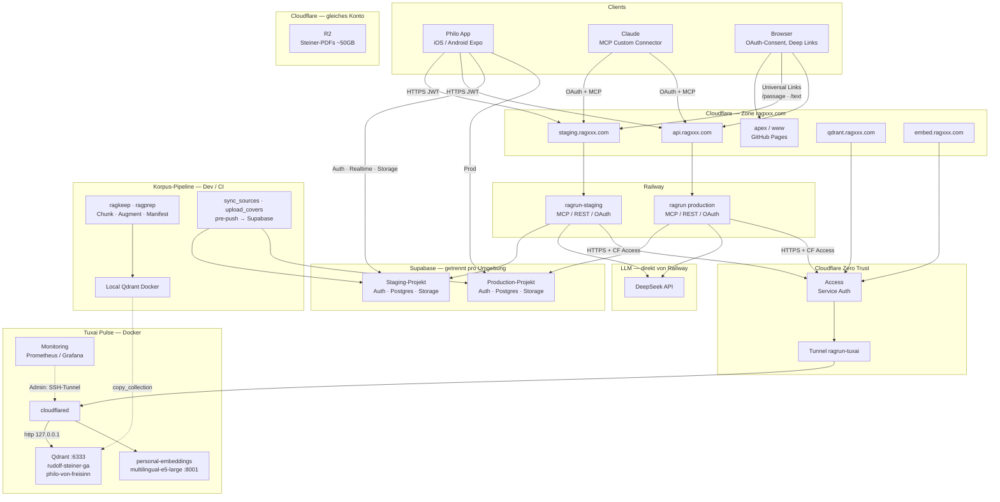
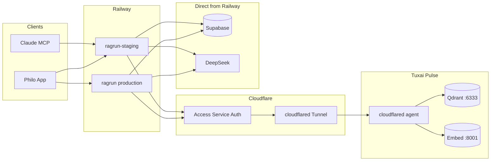

# Plan: Tuxai ↔ Cloudflare ↔ Railway

Kompakter Betriebs- und Rotationsplan. Setup-Schritte: [`cloudflare-tunnel.md`](./cloudflare-tunnel.md). Secret-Ziele und `apply.sh`: [`scripts/secrets/README.md`](../../scripts/secrets/README.md).

## Zielbild Philo (Gesamtarchitektur)

Philo = **ragapp** (Mobile), **ragrun** (API + MCP + OAuth), **ragkeep** (Korpus & Assistenten), **Supabase** (Nutzer & Metadaten), **Tuxai** (Vektor-Korpus + Query-Embeddings). Staging und Production teilen **eine** Qdrant-Instanz und **einen** Embedder auf Tuxai; Nutzerdaten liegen in **getrennten** Supabase-Projekten. Dev arbeitet lokal (`localhost:6333`, `:8001`); bestätigter Korpus geht per Snapshot nach Tuxai (`copy_collection.sh`).



*(R2 im Diagramm-Kasten „Cloudflare — gleiches Konto“: keine App- oder Railway-Anbindung über den Tunnel.)*

### Komponenten (Rollen & URLs)

| Komponente | Repo / Ort | Rolle | Typische URL / Endpunkt |
|------------|------------|-------|-------------------------|
| **Philo App** | `ragapp` | Chat, Bibliothek, Notizen, Handoffs; baut gegen Staging oder Prod | `EXPO_PUBLIC_*` → Supabase + `staging`/`api.ragxxx.com` |
| **ragrun Staging** | Railway `ragrun-staging` | MCP (`/mcp`), App-API, OAuth, Healthz | `https://staging.ragxxx.com` |
| **ragrun Production** | Railway `ragrun` | wie Staging, Prod-Daten | `https://api.ragxxx.com` |
| **Supabase Staging** | Cloud `duhtxxbynkilpxdpcpsk` | Users, `app_notes`, `rag_sources`, Covers, Vortragskatalog | Projekt-URL + Anon Key in App/Railway |
| **Supabase Production** | Cloud `rmdqihhjjyizbuhxkxhn` | wie Staging, getrennte Nutzer | eigene Keys |
| **Qdrant + Embedder** | Tuxai `~/ragrun-server` | **Gemeinsamer** RAG-Korpus + Query-Vektoren für Staging **und** Prod | `https://qdrant.ragxxx.com`, `https://embed.ragxxx.com` (Tunnel) |
| **Cloudflare DNS** | Zone `ragxxx.com` | Railway, Pages, Mail, Tunnel-Hostnames | Weg A — siehe unten |
| **Cloudflare Access** | Zero Trust | M2M: Railway → Tunnel-URLs | Tokens `staging-tuxai`, `prod-tuxai` |
| **Cloudflare R2** | Bucket(s) | Original-PDFs (Steiner), **nicht** MCP-Pfad | API außerhalb `ragxxx.com`-App-Flow |
| **DeepSeek** | Anbieter | Antwort-LLM aus ragrun | `RAGRUN_DEEPSEEK_API_KEY` |
| **ragkeep / ragprep** | lokal / CI | Bücher, Chunks, Assistenten-Manifeste; Push sync Metadaten | Dev-Qdrant → Snapshot Tuxai |
| **GitHub Pages** | `ragxxx.com` / `www` | Marketing / statische Seiten, ggf. AASA/assetlinks-Hosts | DNS in CF, meist **DNS only** |
| **Claude MCP** | Anthropic | `search_corpus`, `get_passage`, Volumes, Vorträge, Handoffs | Connector-URL = Staging oder Prod |

### Umgebungen

| Umgebung | ragrun | Supabase | Qdrant / Embed |
|----------|--------|----------|----------------|
| **Dev** | lokal / ngrok | Dev-Projekt | **localhost** Docker |
| **Staging** | `staging.ragxxx.com` | Staging-Projekt | **Tuxai** (Tunnel) |
| **Production** | `api.ragxxx.com` | Prod-Projekt | **Tuxai** (dieselbe Instanz) |

**Bewusst nicht im Tunnel:** Postgres/Supabase-API, DeepSeek, App↔Supabase — nur **Qdrant** und **Embedding-HTTP** von Railway über Cloudflare.

**Abgrenzung dieses Plans:** Kein Umzug von Railway oder Supabase — nur sicherer **HTTPS-Zugang** Railway → Tuxai (DNS Weg A + Tunnel + Access) und Betrieb/Rotation der zugehörigen Secrets.

## DNS: Zone `ragxxx.com` bei Cloudflare (Weg A)

**Entscheidung:** Die **authoritative DNS-Zone** `ragxxx.com` liegt bei **Cloudflare** (Free). Der **Registrar** (Chris) bleibt; nur die **Nameserver** zeigen auf Cloudflare. Danach trägst **du** (oder Chris mit Zugang) **alle Records** in **Cloudflare → DNS** ein — CNAME, A, TXT, MX — wie bisher bei Chris, plus Tunnel-Einträge für `qdrant` / `embed`.

**Railway hostet kein DNS.** Apps bleiben auf denselben URLs; es ändert sich nur **wo** die Einträge gepflegt werden.

### Warum nicht „nur CNAME bei Chris → cfargotunnel“?

Experiment (Tunnel `ragrun-tuxai`, UUID `ea6798f8-5cde-489f-a9ce-aa1ecfa24e4f`):

- `qdrant.ragxxx.com` → CNAME → `….cfargotunnel.com` war **öffentlich** ok (Google DNS).
- Auflösung von `….cfargotunnel.com` lieferte **AAAA `fd10:aec2:5dae::`**, **keine** nutzbare **IPv4-A** für normale Clients.
- **Railway** (IPv4, kein WARP) und viele Resolver kommen so **nicht** zuverlässig an die Edge.
- **Lösung:** Zone **`ragxxx.com`** im Account + Tunnel-Routes mit Domain **`ragxxx.com`** aus dem Dropdown → **proxied / öffentliche Edge-IPs** für `qdrant` / `embed`.

Nach Weg A: **keine** parallelen Chris-CNAME auf `cfargotunnel.com` für dieselben Namen (Konflikt / fd10 zurück).

### Was unverändert bleibt (Railway & Nutzer)

| Hostname | Dienst | Änderung |
|----------|--------|----------|
| `staging.ragxxx.com` | Railway `ragrun-staging` | **Keine** neue URL; in CF **dieselben** CNAME/TXT wie bei Chris |
| `api.ragxxx.com` | Railway `ragrun` (Prod) | ditto |
| MCP/API in Railway | Custom Domain | **Nicht** neu anlegen, solange DNS-Ziel gleich bleibt |

### Weitere Nutzer der Zone (mit migrieren)

| Nutzung | Typische DNS-Records | Cloudflare-Hinweis |
|---------|----------------------|-------------------|
| **GitHub Pages** | `@` / `www`: A auf GitHub-IPs **oder** CNAME → `*.github.io` (laut Repo → Pages → Custom domain) | Meist **DNS only** (graue Wolke); nach NS-Umstellung in GitHub DNS-Check ggf. erneut |
| **Railway** | `staging`, `api` → CNAME `*.up.railway.app`; TXT `_railway-verify.*` | **DNS only** (grau) empfohlen |
| **Mail** | MX, SPF, DKIM, … | **1:1** von Chris übernehmen |
| **Tunnel** | `qdrant`, `embed` | Über **Zero Trust → Tunnel → Published application** + Zone `ragxxx.com`; CF legt DNS an (often proxied) |

**R2 (Steiner-PDFs):** gleiches CF-Konto, **kein** Zusammenhang mit dieser DNS-Zone.

### DNS selbst verwalten

Ab Zone **Active**: alle **eigenen CNAMEs/A/TXT/MX** in Cloudflare pflegen. Tunnel kann Records für `qdrant`/`embed` **mit** anlegen — nicht zusätzlich manuell auf `cfargotunnel.com` zeigen, wenn die Route schon existiert.

### Weg A — Ablauf (Kurz)

1. **Add a site** → **`ragxxx.com`** (Root, Free) — **nicht** `tunnel.ragxxx.com` (wird vom Wizard abgelehnt).
2. Records **importieren** und **Zeile für Zeile** mit Chris abgleichen (Railway, GitHub Pages, MX, TXT, Apex, …).
3. **Railway/GitHub Pages:** zuerst **DNS only** (graue Wolke), bis alles grün.
4. Chris: **Nameserver** auf Cloudflare → Zone **Active**.
5. Tunnel **`ragrun-tuxai`:** Routes **`qdrant`** / **`embed`** + Domain **`ragxxx.com`** (Dropdown), Service `http://127.0.0.1:6333` / `:8001`.
6. Alte **Chris-CNAME** auf `cfargotunnel` für qdrant/embed entfernen (obsolet, sobald CF autoritativ ist).
7. **Abnahme DNS:** `dig @1.1.1.1` / [Google DNS JSON](https://dns.google/resolve?name=qdrant.ragxxx.com&type=1) → **öffentliche A** (z. B. `104.*` / `172.*`), **kein** fd10-only für den App-Pfad.

Tunnel-Hostnames (fix): **`https://qdrant.ragxxx.com`**, **`https://embed.ragxxx.com`**.

## Entscheidungen (fix)

| Thema | Beschluss |
|-------|-----------|
| Access Service Tokens | **Zwei Tokens:** `staging-tuxai` → `ragrun-staging`, `prod-tuxai` → `ragrun` |
| Rotation | **Nur manuell** (Leak, Incident, bewusster Cutover — kein Kalender) |
| Embeddings auf Railway | `RAGRUN_EMBEDDINGS_PROVIDER=http` über Tunnel (kein HF-Pfad) |
| **Tailscale** | Entfernt (21.10.2026). Kein Paket im Image. `apply.sh` setzt keine `TS_*` mehr und löscht Reste auf Railway. Env-Dateien nutzen die Tunnel-Hostnames. |
| **DNS** | **Weg A:** Zone **`ragxxx.com`** bei Cloudflare; NS via Chris |
| Tunnel-Hostnames | `https://qdrant.ragxxx.com`, `https://embed.ragxxx.com` |

## Tailscale

Abgebaut am 21.10.2026. Der Tunnel ist der einzige Weg von Railway und vom Mac nach Tuxai. `compose.yaml` bindet Qdrant und den Embedder auf `127.0.0.1`. `copy_collection.sh` nutzt `https://qdrant.ragxxx.com`.

**Nicht** wiederbeleben: SOCKS-Proxy auf Railway, Qdrant oder Embedder auf `0.0.0.0` Richtung Internet.

## Datenfluss Railway ↔ Tuxai (Detail)

Ausschnitt aus dem [Zielbild](#zielbild-philo-gesamtarchitektur) — nur der RAG-Backend-Pfad:



| Hop | Protokoll | Authentifizierung |
|-----|-----------|-------------------|
| Client → Railway MCP/API | HTTPS | Supabase OAuth / JWT (Staging vs Prod getrennt) |
| Railway → Tunnel-Hostname | HTTPS | `CF-Access-Client-Id` / `CF-Access-Client-Secret` (je Umgebung); Qdrant zusätzlich `api-key` |
| cloudflared → Origin | HTTP localhost | Nur auf dem Host; Ports `127.0.0.1` |
| Railway → Supabase | HTTPS | JWKS / Tokens |

**Nicht** über den Tunnel: Postgres, Supabase, DeepSeek — bleiben projektbezogen auf Railway.

## Secret-Inventar (nur diese Schicht)

| Secret | Wo lebt es | Wer braucht es | Staging / Prod |
|--------|------------|----------------|----------------|
| Tunnel-Connector-Token / `credentials.json` | Tuxai (`cloudflared`) | Nur `cloudflared` | Geteilt (ein Tunnel) |
| Access Service Token | Cloudflare; Railway | `staging-tuxai` / `prod-tuxai` | **Getrennt** |
| `QDRANT_API_KEY` | Tuxai + Railway | Beide Services | Geteilt (ein Korpus) |

Railway-Variablen: `RAGRUN_QDRANT_URL`, `RAGRUN_EMBEDDINGS_BASE_URL`, `RAGRUN_QDRANT_API_KEY`, `RAGRUN_CF_ACCESS_CLIENT_ID`, `RAGRUN_CF_ACCESS_CLIENT_SECRET`.

## Access: zwei Tokens

Zero Trust → **Access** → **Applications** — je **`qdrant.ragxxx.com`** und **`embed.ragxxx.com`**:

- Policy **Service Auth**, Include: Service Token **`staging-tuxai`** und **`prod-tuxai`** (beide dürfen beide Apps nutzen).
- Keine Human-Identity-Regeln.

Credentials landen getrennt auf Railway (nicht verwechseln).

## Go — Reihenfolge (einmaliger Cutover)

### 1. Tunnel + Tuxai (cloudflared)

Claude auf Mac vs Tuxai: [`prompt-claude-step1-cloudflare.md`](./prompt-claude-step1-cloudflare.md).

1. Zero Trust → Tunnel **`ragrun-tuxai`**, `cloudflared` auf Tuxai, Status **Healthy**.
2. Published routes (vorläufig): `qdrant.ragxxx.com` / `embed.ragxxx.com` → localhost (werden in Schritt 2 an Zone gekoppelt).

### 2. Zone `ragxxx.com` (Weg A) — vor Railway-Cutover

1. Cloudflare **Add site** → **`ragxxx.com`**, Free, DNS-Scan/Import.
2. **Abgleich** mit Chris: **Railway** (`staging`, `api`, Railway-TXT), **GitHub Pages** (`@`/`www`/Subdomain laut GitHub), **MX**, restliche TXT/A.
3. Chris: **Nameserver** → Cloudflare; warten bis **Active**.
4. Tunnel-Routes **neu/sauber:** Subdomain `qdrant` / `embed`, Domain **`ragxxx.com`** (Dropdown), nicht nur Custom Hostname ohne Zone.
5. DNS prüfen: öffentliche **A** für `qdrant.ragxxx.com` (kein fd10-only); `staging`/`api`/`www` wie erwartet.

### 3. Access + Service Tokens

1. Tokens **`staging-tuxai`** / **`prod-tuxai`**; Apps für **`qdrant.ragxxx.com`** und **`embed.ragxxx.com`**, Policy **Service Auth** only.

### 4. Mac: Tunnel testen (vor Railway)

Pro Token einmal:

```bash
cd ragrun
# Werte aus rotate.env / 1Password — nicht committen
export RAGRUN_QDRANT_URL=https://qdrant.ragxxx.com
export RAGRUN_EMBEDDINGS_BASE_URL=https://embed.ragxxx.com
export RAGRUN_QDRANT_API_KEY=...
export RAGRUN_CF_ACCESS_CLIENT_ID=...    # staging-tuxai, dann prod-tuxai
export RAGRUN_CF_ACCESS_CLIENT_SECRET=...
./deploy/tuxai/verify-tunnel.sh
```

### 5. Railway via `apply.sh`

```bash
cp scripts/secrets/rotate.env.example scripts/secrets/rotate.env
chmod 600 scripts/secrets/rotate.env
```

In `rotate.env` mindestens:

```bash
TUNNEL_QDRANT_URL=https://qdrant.ragxxx.com
TUNNEL_EMBED_URL=https://embed.ragxxx.com
STAGING_CF_ACCESS_CLIENT_ID=...
STAGING_CF_ACCESS_CLIENT_SECRET=...
PRODUCTION_CF_ACCESS_CLIENT_ID=...
PRODUCTION_CF_ACCESS_CLIENT_SECRET=...
QDRANT_API_KEY=...          # nur wenn noch nicht überall gleich
APPLY_RAILWAY_STAGING=1
APPLY_RAILWAY_PRODUCTION=0   # Staging zuerst
```

```bash
./scripts/secrets/apply.sh
./scripts/secrets/apply.sh --apply --redeploy
```

Staging grün → `APPLY_RAILWAY_PRODUCTION=1`, Prod-Token eintragen, erneut `--apply --redeploy`.  
`rm -P scripts/secrets/rotate.env`

### 6. Abnahme

**Staging:**

```bash
curl -s https://staging.ragxxx.com/healthz | jq '.dependencies.qdrant, .dependencies.embedding_service'
# MCP-Suche
```

**Production** analog mit `https://api.ragxxx.com/healthz`.

### 7. Tailscale

Erledigt (21.10.2026). Host, Railway und Repo nutzen den Tunnel. Kein Tailnet-Fallback.

## Schlüssel-Rotationsstrategie

Grundsatz: **neu anlegen → überall aktivieren → Health prüfen → altes Secret widerrufen**. Werte nie in Git/Chat; Cutover über `rotate.env` + `apply.sh`.

**Trigger:** ausschließlich **manuell** (Leak, Verdacht, bewusster Wechsel).

### A. Cloudflare Access Service Token

Pro betroffener Umgebung (Staging **oder** Prod — getrennte Tokens):

1. Neuen Service Token in Zero Trust anlegen (oder neuen Token neben dem alten in der Policy erlauben).
2. In `rotate.env` nur `STAGING_CF_ACCESS_*` **oder** `PRODUCTION_CF_ACCESS_*` setzen.
3. `./scripts/secrets/apply.sh --apply --redeploy`
4. Healthz + optional `verify-tunnel.sh` mit dem neuen Token.
5. Alten Token in Cloudflare **revoken**.
6. `rotate.env` löschen.

### B. `QDRANT_API_KEY`

Siehe [`scripts/secrets/README.md`](../../scripts/secrets/README.md): Railway zuerst ohne Redeploy → Tuxai → Redeploy.

### C. Tunnel-Connector (`cloudflared`)

Selten; siehe frühere Plan-Version — Rotate token in CF, Tuxai neu starten, Hostnames unverändert.

## Rollout-Checkliste

Stand **16.10.2026**: Cutover-Abnahme **manuell** (Healthz, MCP in Claude, ggf. `verify-tunnel.sh` vom Mac). Kein automatisierter Ebene-A-Lauf als Gate.

- [x] Tunnel **Healthy** + `cloudflared` auf Tuxai (Qdrant/Embed über Hostnames erreichbar; Railway-Healthz grün)
- [x] Zone **`ragxxx.com`** Active; NS bei Chris
- [x] DNS 1:1: **Railway**, **GitHub Pages**, MX, TXT
- [x] Tunnel-Routes mit Domain **`ragxxx.com`**; qdrant/embed **öffentliche A**, kein fd10-only
- [x] Tokens `staging-tuxai`, `prod-tuxai` + Access auf beiden Hostnames
- [ ] `verify-tunnel.sh` für beide Tokens (optional; manuell vom Mac)
- [x] Staging Railway: Tunnel-URLs, CF Access
- [x] Staging Healthz + MCP (manuell)
- [x] Production Railway: Tunnel-URLs, CF Access; `RAGRUN_MCP_BASE_URL=https://api.ragxxx.com`
- [x] Production Healthz + MCP (manuell); Prod-Supabase-Korpus (Katalog u. a.) von Staging synchronisiert
- [x] **7a / 7b** Tailscale abgebaut (21.10.2026). Repo: kein Paket im Image, Tunnel-URLs in den Env-Dateien, `copy_collection.sh` auf `https://qdrant.ragxxx.com`
- [ ] `rotate.env` löschen, wenn keine Rotation mehr offen
- [ ] `RAGRUN_HF_TOKEN` auf Railway optional entfernen (nicht genutzt bei `provider=http`)

## Monitoring & Incident

| Signal | Aktion |
|--------|--------|
| `403` auf Tunnel-URL | Falsches Token-Paar (Staging vs Prod vertauscht?) |
| `401` Qdrant | Key-Mismatch Tuxai vs Railway |
| Tunnel **Down** | Tuxai `systemctl status cloudflared-ragrun` |
| Nur Staging kaputt | `staging-tuxai`-Credentials auf `ragrun-staging` prüfen |
| `curl` / Mac **fd10**, Railway timeout | DNS noch cfargotunnel-only → **Weg A** Zone + Routes an `ragxxx.com` |
| GitHub Pages down nach NS | Pages-Records in CF prüfen; ggf. grau; GitHub Custom domain erneut speichern |

## Dokumente

| Datei | Inhalt |
|-------|--------|
| [`cloudflare-tunnel.md`](./cloudflare-tunnel.md) | Einrichtung, Troubleshooting |
| [`verify-tunnel.sh`](./verify-tunnel.sh) | Mac-Probe vor/nach Cutover |
| [`scripts/secrets/README.md`](../../scripts/secrets/README.md) | `apply.sh`, Qdrant-Reihenfolge |
